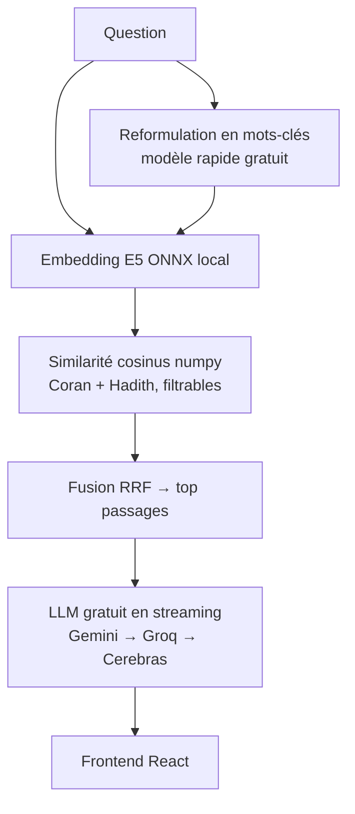

# 📖 IA Coran — Assistant Coranique et Prophétique Intelligent

> Moteur de recherche sémantique et assistant RAG (Retrieval-Augmented Generation) basé sur le Saint Coran et les Hadiths authentiques (Sahih al-Bukhari). Posez vos questions en langage naturel et recevez des réponses sourcées, précises et sans hallucination.

---

## ✨ Fonctionnalités Principales

| Fonctionnalité | Description |
|----------------|-------------|
| **Recherche Sémantique** | Trouve des versets et des ahadith par le sens (question + reformulation fusionnées par RRF) |
| **Filtres de Sources** | Recherche au choix : `Coran uniquement`, `Hadith uniquement` ou `Les deux` |
| **Assistant IA (RAG)** | Répond aux questions en citant les textes avec leur référence exacte |
| **IA 100 % gratuite** | Gemini, Groq ou Cerebras (offres gratuites), avec bascule automatique si un quota est atteint |
| **Streaming temps réel** | Réponse affichée au fil de l'eau (NDJSON) |
| **Anti-hallucination** | L'IA ne répond qu'à partir des passages fournis |
| **Normalisation NLP** | Gestion des accents, harakat arabes et variantes orthographiques |
| **Comptes et Abonnements** | Authentification et quotas quotidiens par plan |
| **Multi-conversations** | Historique persistant avec barre latérale |
| **Thème Clair / Sombre** | Basculement automatique et manuel (persistant) |

---

## 🏗️ Architecture du Projet

```text
iacoran/
├── core/                         # Configuration Django (settings, urls, wsgi)
├── quran_api/                    # Application Django
│   ├── views.py                  # Endpoints REST (auth, search, ask, streaming, health)
│   ├── models.py                 # UserProfile, SubscriptionPlan, ChatHistory
│   ├── management/commands/      # seed_plans
│   ├── tests.py                  # Tests (sans modèle ni clé API)
│   └── services/
│       ├── rag.py                # Pipeline : reformulation → recherche → réponse (prompts)
│       ├── llm_service.py        # Fournisseurs LLM gratuits + bascule automatique
│       ├── vector_service.py     # Recherche vectorielle numpy (Coran + Hadith)
│       ├── embedder.py           # Embeddings E5 sur ONNX Runtime (sans PyTorch)
│       ├── model_assets.py       # Téléchargement épinglé + vérifié (SHA-256) du modèle
│       └── text_utils.py         # Normalisation FR/AR
├── data/
│   ├── raw/                      # quran_complet.json, bukhari_complet.json (textes sources)
│   └── index/                    # Index compact : vectors.npy, docs.json.gz, manifest.json (~25 Mo)
├── scripts/
│   ├── build_index.py            # Reconstruit l'index depuis data/raw (ONNX, sans PyTorch)
│   ├── convert_legacy_index.py   # Convertit les anciens *_indexed.zip sans recalcul
│   ├── trim_vocab.py             # Réduit le vocabulaire du modèle (étape du build Docker)
│   └── fetch_hadith.py           # Télécharge Sahih al-Bukhari (FR + AR)
├── frontend/                     # React 19 + Vite + Tailwind
├── Dockerfile · entrypoint.sh · gunicorn.conf.py · render.yaml
└── requirements.txt
```

---

## 🧠 Pipeline RAG



- **Embeddings** : `intfloat/multilingual-e5-base` exporté en ONNX int8, exécuté localement (gratuit, sans quota, ~50 ms par requête). Le vocabulaire est réduit aux tokens utiles (tous ceux du corpus + les 40 000 plus fréquents) : le modèle passe de 279 à 131 Mo, avec des résultats identiques pour les questions en français et en arabe.
- **Recherche** : ~14 000 vecteurs → un simple produit matriciel numpy (quelques ms), sans FAISS.
- **LLM** : fournisseurs compatibles OpenAI essayés dans l'ordre ; seuls ceux qui ont une clé sont actifs. Si l'un échoue (quota gratuit, panne), le suivant répond.

| Fournisseur | Modèle principal | Modèle rapide (reformulation) | Clé gratuite |
|---|---|---|---|
| Google AI Studio | `gemini-3.8-flash` | `gemini-3.5-flash-lite` | https://aistudio.google.com/apikey |
| Groq | `openai/gpt-oss-120b` | `openai/gpt-oss-20b` | https://console.groq.com/keys |
| Cerebras | `gpt-oss-120b` | `gpt-oss-120b` | https://cloud.cerebras.ai |

Les modèles se changent sans toucher au code via les variables `GEMINI_MODEL`, `GROQ_MODEL`, etc. (voir `.env.example`).

---

## 📦 Installation & Démarrage Local

### Pré-requis
- **Python 3.12+** et **Node.js 18+**
- Au moins une clé gratuite : **Gemini** et/ou **Groq** (recommandé : les deux, pour la bascule)

### Backend

```powershell
python -m venv venv
.\venv\Scripts\activate          # ou: source venv/bin/activate
pip install -r requirements.txt

copy .env.example .env           # ou: cp .env.example .env — puis renseigner les clés

python manage.py migrate
python manage.py seed_plans
python manage.py runserver       # le modèle ONNX (~280 Mo) est téléchargé au 1er lancement
```

L'index (`data/index/`) est fourni : **aucune indexation n'est nécessaire.**

Optionnel : utiliser aussi en local le modèle réduit (~150 Mo de RAM en moins) :

```powershell
pip install onnx
python scripts/trim_vocab.py models/multilingual-e5-base models/e5-trimmed
# puis dans .env : EMBEDDING_MODEL_DIR=models/e5-trimmed
```

### Frontend

```powershell
cd frontend
npm install
npm run dev                      # http://localhost:3000 (proxy /api → :8000)
```

Pour tester sur l'iPhone pendant le développement : `npm run dev -- --host`, puis ouvrir `http://<IP-du-PC>:3000` dans Safari (même réseau Wi-Fi).

### Interface (mobile d'abord)

- **Univers « Banco »** : inspiré des mosquées en terre crue du Sahel. Latérite pour l'en-tête et la barre de saisie, badigeon de kaolin pour la lecture, logo vert et or conservé. Mode **Nuit** pour l'usage avant Fajr ; **Auto** suit le réglage de l'iPhone.
- **Les sources sortent du mur** : sous chaque réponse, chaque passage est une poutre de rônier dont la longueur indique la pertinence. Toucher une poutre, ou une citation comme « (2:153) » dans le texte, ouvre le verset : arabe (police Harmattan, conçue pour l'arabe d'Afrique de l'Ouest), traduction et récitation.
- **Réglages** : thème, taille du texte (4 niveaux, arabe compris ; la taille du texte d'iOS est aussi respectée), récitation automatique.
- **Accessibilité** : contrastes WCAG AA en jour et en nuit, cibles tactiles de 44 pt, VoiceOver (arabe balisé `lang="ar"`), mouvement réduit respecté.
- **App sur l'écran d'accueil** : dans Safari, Partager → « Sur l'écran d'accueil ». Un service worker met l'interface et les polices en cache pour les connexions lentes ; l'API et l'audio passent toujours par le réseau.

### Tests

```powershell
python manage.py test quran_api
```

### Reconstruire l'index (seulement si les textes changent)

```powershell
python scripts/fetch_hadith.py   # optionnel : re-télécharger Bukhari
python scripts/build_index.py    # embeddings ONNX (long sur CPU)
```

---

## 🚀 Déploiement (Render)

`render.yaml` décrit le service Docker + PostgreSQL. Au déploiement, renseigner `GEMINI_API_KEY` et/ou `GROQ_API_KEY` (et `DJANGO_SUPERUSER_PASSWORD` pour créer l'admin).

| | Avant | Après |
|---|---|---|
| Dépendances Python | 81 paquets (PyTorch, transformers, scipy, FAISS, SDK Google…) | 32 paquets (12 directs), ~230 Mo installés |
| Données d'index | 108 Mo de zips → 264 Mo de JSON parsés en RAM | 25 Mo (float16 + JSON gzip) |
| Modèle d'embedding | PyTorch fp32 ~1,1 Go, téléchargé au 1er appel de chaque conteneur | ONNX int8 réduit 131 Mo, intégré à l'image |
| RAM | estimée à ~2 Go par worker, ×2 workers | ~390 Mo au pic (mesuré), 1 worker + 8 threads |
| Démarrage | téléchargement du modèle + parsing JSON au 1er appel | ~2 s, chargé avant d'accepter le trafic |

---

## 🔌 API

| Méthode | Route | Description | Auth |
|---|---|---|---|
| GET | `/api/health/` | Sonde de santé (Render) | — |
| POST | `/api/auth/register/` | Création de compte | — |
| POST | `/api/auth/login/` | Obtenir un token | — |
| GET | `/api/history/` | 50 dernières questions | Token |
| GET | `/api/search/?q=…&limit=5&source_filter=both` | Recherche sémantique seule (sans LLM) | — |
| POST | `/api/ask/` | Question → réponse sourcée (JSON) | Token, quota |
| POST | `/api/ask/stream/` | Question → réponse en streaming NDJSON | Token, quota |

Le streaming envoie `{"type":"sources"}`, puis des `{"type":"token"}`, puis `{"type":"done"}`. Les erreurs arrivent sous la forme `{"type":"error","error_code":"limit_reached"|"llm_unavailable"}`.

---

## 👤 Auteur

abibou
